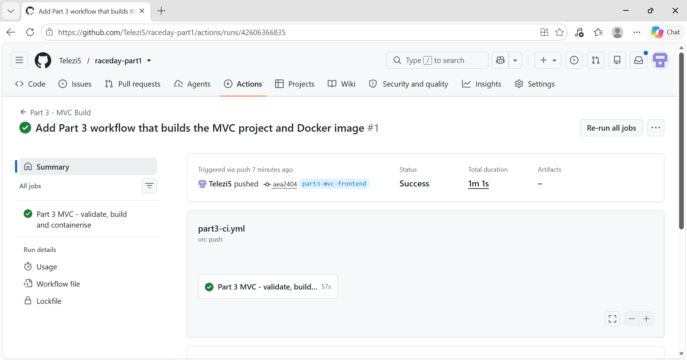

# RaceDay - Part 3: MVC Web Application

RaceDay is a South African running, walking and cycling event management platform. Part 3 adds the ASP.NET Core MVC front end that consumes the Part 2 RESTful API. Images are uploaded through the API to Azure Blob Storage (the Azurite emulator), and the MVC application is containerised with Docker.

**Demo video (unlisted YouTube):** https://youtu.be/hJg54AS2Cfw

## Features

**Organiser**
- Dashboard: total events, total enrolments, enrolments per event, upcoming event dates
- Events: create, edit and delete events (name, description, date, location, distance, type) with banner image upload
- Categories: add and remove age or distance categories per event
- Enrolments: see every participant enrolled in an event, with category and status
- Results: capture and publish finish times and finishing positions

**Participant**
- Home: all upcoming events with filters (city, date, type)
- Event details: full information, venue and route, available categories, Enter Event
- My Events: enrolments with colour-coded status
- My Results: race history with finish time and position (for example "1st of 1 finishers")
- Profile: view and update details, upload a profile picture

**Everywhere**
- Session-based login, register and logout, with role-specific navigation and protected pages
- Bootstrap RaceDay theme, consistent across every page, with friendly error messages

## Architecture

    MVC app (Part3-MVC/RaceDay.Web)  -->  Part 2 REST API (Part2-API)  -->  SQL Server + Azure Blob Storage

The MVC project has no database access and does not talk to Azure. All data and all file uploads go through the API.

## Prerequisites

- Docker Desktop
- Visual Studio with the .NET 10 SDK (to run the Part 2 API)
- The Part 2 database already created (EF Core migrations applied)

## Run with Docker

**1. Start the Azure Blob Storage emulator (Azurite), one time:**

    docker run -d --name azurite --restart unless-stopped -p 10000:10000 mcr.microsoft.com/azure-storage/azurite azurite-blob --blobHost 0.0.0.0 --skipApiVersionCheck

**2. Start the Part 2 API.** Open `Part2-API/RaceDay/RaceDay.slnx` in Visual Studio, choose the `https` profile and press F5. The API listens on https://localhost:7110.

**3. Start the MVC application with a single command**, from the `Part3-MVC/RaceDay.Web` folder:

    docker compose up --build -d

Open http://localhost:8080 in your browser.

To stop it:

    docker compose down

Equivalent plain Docker commands:

    docker build -t raceday-web .
    docker run -d --name raceday-web -p 8080:8080 -e ApiBaseUrl=https://host.docker.internal:7110/ -e ApiAllowUntrustedCertificate=true --add-host host.docker.internal:host-gateway raceday-web

## Run locally without Docker

Open `Part3-MVC/RaceDay.Web` in Visual Studio, start the API as above, then press F5 on the MVC project (https://localhost:7130). The application behaves identically in the container and locally.

## Registering test users

- Participant: register with the role Participant.
- Organiser: register with the role Organiser and the organiser key `RACEDAY-ORG-2026`.

## Azure Blob Storage note

No Azure subscription was available for this project, so the official Azure Storage emulator (Azurite) is used. The API uses the real `Azure.Storage.Blobs` SDK, so using a real storage account only means replacing `BlobStorage:ConnectionString` in the API's `appsettings.json`. Uploaded files are stored in the `raceday-images` container and their URLs are saved in the database.

## GitHub and CI/CD

- Part 3 work is on the branch `part3-mvc-frontend`, in the `Part3-MVC` folder.
- GitHub Actions runs on every push: `.github/workflows/part2-ci.yml` builds and tests the Part 2 API, and `.github/workflows/part3-ci.yml` validates the Part 3 repository structure, builds the MVC project and builds the Docker image.

